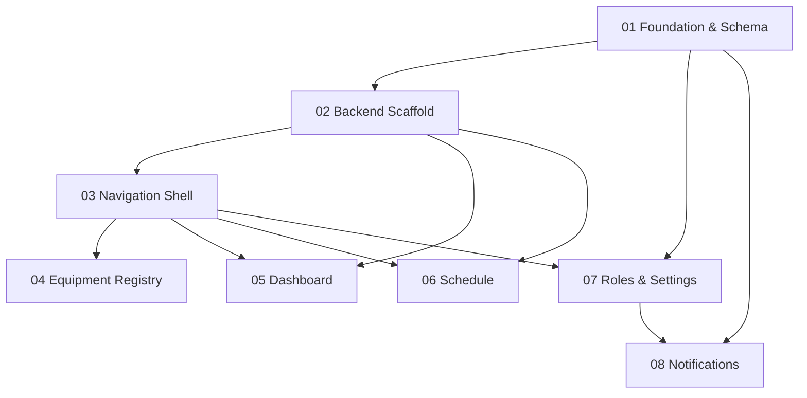

# EMS Phase 1 — Implementation Plan Overview

**Source spec:** [EMS_Phase1_Spec.md](../EMS_Phase1_Spec.md)  
**Created:** 2026-06-09  
**Target delivery:** 1–2 months from kickoff  
**Strategy:** Reuse existing calibration dashboard UI + backend; copy/rename into `/ems` module; equipment registry reads from `dbo.IgxEQExtension`.

---

## Current State (as of plan creation)

| Area | Status | Notes |
|---|---|---|
| Equipment Excel import | **Done** | **287 rows** in `dbo.IgxEQExtension` on `CEDAR` (cedar_new MCP) — all linked via `eqno` → `dbo.EQ`. Spec cited 1,228; confirm if more imports pending. See [IgxEQExtension-Column-Map.md](./IgxEQExtension-Column-Map.md) |
| EMS dashboard UI | **Done** | `/ems/dashboard` — KPI tiles + overdue / due-this-week / due-soon panels (Phase 05) |
| Calibration dashboard UI | **Done** | `DashboardCalibrationV2Page` at `/dashboard/calibration-v2` — kept until EMS validated |
| Calibration backend | **Done** | `/api/dashboard/calibration/*` + `/api/dashboard/calibration/pm-schedule/*` |
| Calibration notifications | **Partial** | `calibrationDueDateNotificationJob` — 7-day pre-due; EMS spec needs 30-day + 14-day escalation |
| EMS schedule UI | **Done** | `/ems/schedule` — filterable PM schedule table + KPI summary (Phase 06) |
| EMS routes / pages | **Done** | `/ems/*` dashboard, equipment, schedule, settings |
| EMS role tables | **Done** | `IgxEmsUserRole`, `IgxEmsManagerArea` (Phase 01) |
| Equipment registry UI | **Done** | List + detail pages with filters, pagination, mobile cards (Phase 04) |

---

## Sub-Phase Breakdown

| # | Plan | Focus | Est. effort | Depends on |
|---|---|---|---|---|
| 01 | [01-Foundation-Schema.md](./01-Foundation-Schema.md) | DB tables, `IgxEQExtension` column mapping, EMS auth middleware | 2–3 days | — |
| 02 | [02-Backend-Scaffold.md](./02-Backend-Scaffold.md) | Copy calibration controllers → `routes/ems.js`, mount in `app.js` | 2–3 days | 01 |
| 03 | [03-Navigation-Shell.md](./03-Navigation-Shell.md) | Sidebar rail item, `/ems/*` routes, `EmsLayout` | 1–2 days | 02 (partial) |
| 04 | [04-Equipment-Registry.md](./04-Equipment-Registry.md) | Equipment list + detail pages (net-new) | 4–5 days | 01, 02, 03 |
| 05 | [05-Dashboard.md](./05-Dashboard.md) | EMS dashboard — adapt existing calibration dashboard | 2–3 days | 02, 03 |
| 06 | [06-Calibration-Schedule.md](./06-Calibration-Schedule.md) | Schedule page — adapt PM schedule list | 2 days | 02, 03 |
| 07 | [07-Roles-Settings.md](./07-Roles-Settings.md) | Role assignment + manager area config UI/API | 3–4 days | 01, 02, 03 |
| 08 | [08-Notifications.md](./08-Notifications.md) | EMS notification rules (30-day, overdue, 14-day escalation) | 3–4 days | 01, 07 |

**Total estimate:** ~3–4 weeks of focused dev (within spec's 1–2 month window including QA/stakeholder review).

---

## Dependency Flow



---

## Key Architectural Decisions

### 1. Use `dbo.IgxEQExtension` instead of `IgxEquipment`

The spec originally defined `IgxEquipment`. Equipment data is already imported into **`dbo.IgxEQExtension`** (287 rows verified via `cedar_new` MCP). All EMS equipment queries join via **`ext.eqno = eq.EQNO`**; `ext.tag_no` matches `eq.EQCODE`.

Key mapping deltas from spec:
- **`area`** → column is `location`
- **`is_active` / `is_duplicate_tag`** → not in table; use `eq.FLAGDEL` for active filter
- **`plant`** → derived from first segment of `tag_no` (DP=228, DJ=21, ST=16, SN=13, PIP=9)

Full mapping: [IgxEQExtension-Column-Map.md](./IgxEQExtension-Column-Map.md)

### 2. Copy-and-rename calibration code into EMS module

Do **not** refactor the existing `/dashboard/calibration-v2` routes in place. Instead:

```
backend/src/routes/ems.js                          ← new mount at /api/ems
backend/src/controllers/ems/
  dashboardController.js                           ← fork from calibrationController.js
  scheduleController.js                            ← fork from pmCalibrationScheduleController.js
  equipmentController.js                           ← net-new (IgxEQExtension + Cedar WO/PM)
  roleController.js                                ← net-new
backend/src/services/ems/
  statusCalculationService.js                      ← extract OVERDUE/DUE SOON/OK/NO WO logic
  emsNotificationService.js                        ← extend calibrationDueDateNotificationService.js

frontend/src/pages/ems/                            ← copy/adapt from dashboard/calibration
frontend/src/components/ems/                         ← copy/adapt calibration components
frontend/src/services/emsService.ts                ← fork from calibrationService.ts
```

Keep `/dashboard/calibration-v2` working until EMS is validated, then deprecate.

### 3. Cedar DB connection

Existing calibration code uses **`dbConfigNew`** (Cedar new schema). EMS must use the same connection for `dbo.PM`, `dbo.PMSched`, `dbo.WO`, `dbo.EQ`.

### 4. Permission model

| Access | Rule |
|---|---|
| EMS module entry | EMS role in `IgxEmsUserRole` **OR** `levelReport >= 2` |
| Role settings (`/ems/settings/roles`) | `levelReport = 3` **OR** EMS `plant_manager` role |

Implement `requireEmsAccess` and `requireEmsAdmin` middleware in Phase 01.

### 5. Status calculation (shared logic)

| Status | Rule |
|---|---|
| `NO WO` | No active/open WO linked to equipment PM schedule |
| `OVERDUE` | WO exists, not closed, due date < today |
| `DUE SOON` | WO due within 8–30 days |
| `OK` | WO due > 30 days OR completed within grace |

Reuse classification logic from `helps/calibration-classification-guideline.md` and `calibrationController.js`.

---

## Reuse Inventory

### Backend — copy with minimal changes

| Source | EMS target | Changes needed |
|---|---|---|
| `controllers/calibrationController.js` | `controllers/ems/dashboardController.js` | Rename exports; update deep links to `/ems/equipment/:tagNo` |
| `controllers/pmCalibrationScheduleController.js` | `controllers/ems/scheduleController.js` | Enrich rows with `IgxEQExtension` fields |
| `helpers/pmCalibrationScheduleQuery.js` | Keep shared (import from EMS) | Add optional join to `IgxEQExtension` |
| `jobs/calibrationDueDateNotificationJob.js` | `jobs/emsNotificationJob.js` | New notification_type `ems_calibration`; extend rules |
| `services/calibrationDueDateNotificationService.js` | `services/ems/emsNotificationService.js` | 30-day pre-due, daily overdue, 14-day PM escalation |

### Frontend — copy with route/API changes

| Source | EMS target | Changes needed |
|---|---|---|
| `pages/dashboard/DashboardCalibrationV2Page.tsx` | `pages/ems/DashboardPage.tsx` | Swap API base to `emsService`; simplify tabs per spec |
| `components/dashboard/calibration/CalibrationOverduePanel.tsx` | `components/ems/dashboard/OverduePanel.tsx` | Link to `/ems/equipment/:tagNo` |
| `components/dashboard/calibration/CalibrationBigCalendar.tsx` | Optional — not in Phase 1 spec | Skip unless stakeholder wants calendar |
| `services/calibrationService.ts` | `services/emsService.ts` | Point to `/api/ems/*` |
| `utils/pmCalibrationPlantMap.ts` | Reuse as-is | Shared plant prefix map |

### Net-new (no reuse)

- Equipment list page with filters + pagination
- Equipment detail page (4 sections per spec)
- Role settings page (`RoleAssignmentTable`, `ManagerAreaConfig`)
- EMS sidebar rail item (Gauge icon, top-level — not under Dashboard submenu)

---

## Acceptance Criteria Mapping

| Spec §12 criterion | Sub-phase |
|---|---|
| 1,228 records importable | **Done** — verify count in 01 |
| Equipment list < 2s, search, filters | 04 |
| Equipment detail (spec + WO + history) | 04 |
| Status badge accuracy | 01 (service) + 04 (UI) |
| KPI tiles from Cedar WO data | 05 |
| Overdue panel sorted descending | 05 |
| Plant/Area filter on dashboard | 05 |
| Mobile 375px layout | 03, 04, 05 |
| 30-day pre-due notification | 08 |
| Daily overdue notification | 08 |
| 14-day PM escalation | 08 |
| Deep link to equipment detail | 08 |
| Configurable via IgxNotificationSchedule | 08 |
| L3 assigns EMS roles | 07 |
| EMS role on user profile | 07 |
| Plant Manager configures areas | 07 |

---

## Open Questions (from spec §14)

Track resolution in each sub-phase plan:

| # | Question | Resolve in |
|---|---|---|
| 1 | Exact Cedar `dbo.WO` column names (assignee, due_date) | 01, 02 — already used in calibrationController |
| 2 | Cedar write-back | Out of scope Phase 1 |
| 3 | Plant prefix mapping | Done — `pmCalibrationPlantMap.ts` / `PM_CAL_PLANTS` |
| 4 | LINE channel for EMS | 08 — default: same channel as EDEN |
| 5 | AM role plant/area list | 07 — customer provides at go-live |

---

## Suggested Sprint Order

**Sprint 1 (Week 1):** 01 → 02 → 03  
**Sprint 2 (Week 2):** 04 + 05 (parallel if 2 devs)  
**Sprint 3 (Week 3):** 06 + 07  
**Sprint 4 (Week 4):** 08 + QA against §12 acceptance criteria

---

## File Layout (target end state)

```
ems/docs/
  EMS_Phase1_Spec.md
  Plan/
    00-Overview.md          ← this file
    01-Foundation-Schema.md
    02-Backend-Scaffold.md
    03-Navigation-Shell.md
    04-Equipment-Registry.md
    05-Dashboard.md
    06-Calibration-Schedule.md
    07-Roles-Settings.md
    08-Notifications.md
```
