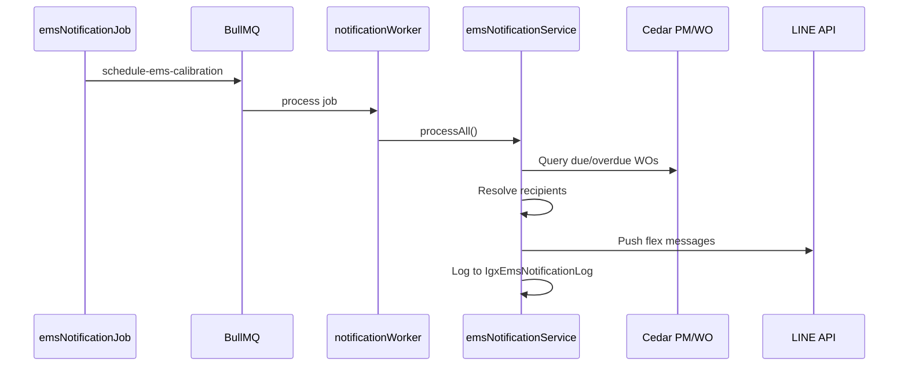

# Sub-Phase 08 — Notifications

**Goal:** EMS calibration notifications via existing BullMQ pipeline — 30-day pre-due, daily overdue, 14-day Plant Manager escalation.  
**Est. effort:** 3–4 days  
**Depends on:** [01](./01-Foundation-Schema.md), [07](./07-Roles-Settings.md)

---

## Spec Reference (§9)

| Trigger | Recipient | Channel |
|---|---|---|
| WO due in exactly 30 days | WO assignee (Cedar PM.ASSIGN) | LINE + email |
| WO overdue (past due, not closed) | WO assignee | LINE + email (daily) |
| WO 14+ days overdue | Plant Manager(s) for plant (IgxEmsManagerArea) | LINE + email |

Deep link: `[LIFF URL]/ems/equipment/:tagNo`

Scheduler: cron via `IgxNotificationSchedule` where `notification_type = 'ems_calibration'`

---

## Reuse Strategy

### Existing calibration notification stack

| File | Role |
|---|---|
| `jobs/calibrationDueDateNotificationJob.js` | Cron → enqueue BullMQ job |
| `services/calibrationDueDateNotificationService.js` | Query due WOs, build LINE flex, send |
| `workers/notificationWorker.js` | Processes queue jobs |
| `queues/notificationQueue.js` | Job producer |

Current calibration notifications: **7-day pre-due window**. EMS spec requires **30-day pre-due** + **14-day PM escalation** — extend, don't replace (keep both notification types unless stakeholder says merge).

---

## Tasks

### 8.1 EMS notification cron job

**File:** `backend/src/jobs/emsNotificationJob.js`

Copy pattern from `calibrationDueDateNotificationJob.js`:

```js
const NOTIFICATION_TYPE = 'ems_calibration';
// Reads IgxNotificationSchedule for cron expression
// Enqueues: notificationQueue.add('schedule-ems-calibration', {})
```

Register in `app.js`:

```js
const emsNotificationJob = require('./jobs/emsNotificationJob');
await emsNotificationJob.initialize();
```

Env disable: `ENABLE_EMS_CALIBRATION_NOTIFICATIONS=false`

---

### 8.2 EMS notification service

**File:** `backend/src/services/ems/emsNotificationService.js`

Fork from `calibrationDueDateNotificationService.js` with rule changes:

#### Query 1 — 30-day pre-due (run once per WO)
```sql
-- PMSched due date = TODAY + 30 days
-- WO not closed (WOSTATUSNO not in finished set)
-- PMCODE contains '-CAL'
-- Dedupe: track sent notifications (see 8.4)
```

#### Query 2 — Overdue (run daily)
```sql
-- Due date < TODAY, WO not closed
-- Send to PM.ASSIGN assignee every day until closed
```

#### Query 3 — 14-day escalation
```sql
-- Due date < TODAY - 14 days, WO not closed
-- Resolve Plant Manager(s) from IgxEmsManagerArea WHERE plant = equipment plant
-- If area-specific row exists, match area; else fall back to plant-wide (area IS NULL)
```

Use `dbConfigNew` for Cedar queries, `dbConfig` for Igx tables.

---

### 8.3 LINE flex message template

Update deep link from `/dashboard/calibration-v2` to `/ems/equipment/:tagNo`.

**File:** Extend `services/ems/emsNotificationService.js` or create `services/ems/emsFlexMessageService.js`

Flex bubble contents (spec §9.3):
- Equipment Tag No. + Description
- Due Date
- Days until / days overdue
- Button → equipment detail deep link

Reuse `abnormalFindingFlexService` push infrastructure.

---

### 8.4 Notification deduplication

Prevent spam for 30-day alert (send once):

**Option A:** New table `IgxEmsNotificationLog`
```sql
CREATE TABLE IgxEmsNotificationLog (
  id INT IDENTITY PRIMARY KEY,
  pm_sch_no INT NOT NULL,
  notification_rule NVARCHAR(50),  -- 'pre_due_30' | 'overdue_daily' | 'escalation_14'
  sent_at DATETIME DEFAULT GETDATE(),
  recipient_person_no NVARCHAR(50)
);
```

**Option B:** Reuse existing notification log if one exists in codebase — check before creating.

For daily overdue: allow one send per calendar day per WO per recipient.

---

### 8.5 Worker handler

**File:** `backend/src/workers/notificationWorker.js`

Add case for job name `schedule-ems-calibration`:

```js
case 'schedule-ems-calibration':
  await emsNotificationService.processAll();
  break;
```

---

### 8.6 Email channel

Reuse existing Resend email service (`emailService.js`) if calibration notifications already send email — mirror template for EMS with same deep link.

If calibration is LINE-only today, add email as net-new following ticket notification email pattern.

---

### 8.7 Admin schedule configuration

Notification cron already configurable via `IgxNotificationSchedule` (seeded in Phase 01).

Document default: daily 07:00 Asia/Bangkok. Admin can adjust via existing notification schedule admin UI if one exists, or direct DB update.

---

### 8.8 Resolve assignee → LINE user ID

Follow existing calibration notification pattern:
- Cedar `PM.ASSIGN` → Person → LINE user ID lookup
- Same mapping used in ticket notifications

Verify assignee resolution works for calibration PM rows (Open Question #1 — already solved in calibration service).

---

## Notification Flow



---

## Testing Plan

| Scenario | Setup | Expected |
|---|---|---|
| 30-day pre-due | PMSched DUEDATE = today + 30 | Assignee gets LINE once |
| Overdue daily | PMSched DUEDATE = yesterday, WO open | Assignee gets LINE today |
| No duplicate 30-day | Run job twice same day | Second run skips (log check) |
| 14-day escalation | DUEDATE = today - 15 | Plant Manager for plant gets LINE |
| WO closed | WOSTATUSNO = 9 | No notification |
| Deep link | Tap LINE button | Opens `/ems/equipment/:tagNo` in LIFF |

Use `npm run worker` + manual job enqueue for dev testing:

```js
// In node REPL or test script
notificationQueue.add('schedule-ems-calibration', {});
```

---

## Checklist (spec §12)

- [x] 30-day pre-due LINE push reaches WO assignee with correct equipment info
- [x] Overdue alert sends daily until WO is closed
- [x] 14-day escalation reaches configured Plant Manager
- [x] Notification includes deep link to equipment detail page
- [x] Schedule configurable via `IgxNotificationSchedule`
- [x] Job disable env var works
- [x] Email channel works (if in scope for go-live)

---

## Open Question #4

**LINE channel:** Default to same EDEN channel unless customer requests separate EMS channel. Document in deployment notes.

---

## Relationship to Existing Calibration Notifications

| Feature | `calibration_due_date` (existing) | `ems_calibration` (new) |
|---|---|---|
| Pre-due window | 7 days | 30 days |
| Overdue daily | ? | Yes |
| PM escalation | No | 14 days |
| Deep link | `/dashboard/calibration-v2` | `/ems/equipment/:tagNo` |

**Recommendation:** Run both jobs in parallel during transition. Deprecate 7-day job when EMS notifications validated.

---

## Out of Scope

- Power Automate channel (production offline — already implemented elsewhere, wire in if needed)
- In-app notification bell for EMS
- User preference opt-out
